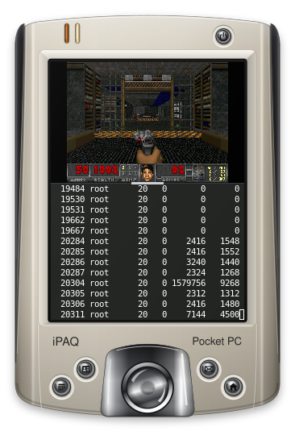
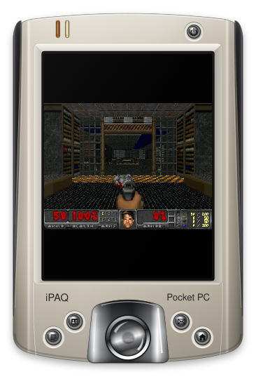
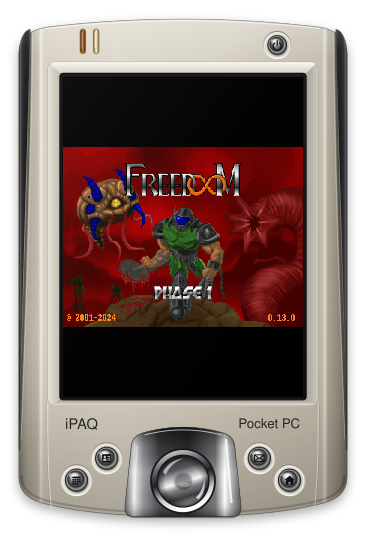

# picoDoom

PicoDoom is Doom for small handhelds: about 64 MiB of RAM, a QVGA-class panel (240x320) and no GPU. It is a fork of [doomgeneric](https://github.com/ozkl/doomgeneric), kept close to upstream, with a Wayland back end for the picowl compositor, sound effects and music through ALSA, and changes that make the renderer and the present step cheaper on an ARMv5 core without an FPU. HP iPAQs are the example and test devices.

The game itself is the doomgeneric port of the Chocolate Doom code base. A WAD is needed: the shareware `doom1.wad`, or [Freedoom](https://freedoom.github.io/), which is what the tests use.

## Features

- Wayland: a window in `wl_shm` buffers that follows the size the compositor configures, fullscreen, application id and title, key map from the command line, the screen kept on while the window is shown. The converter from the 320x200 indexed frame to RGB565 is unrolled for the window widths that occur and can damage only the rows that changed.
- Sound effects: an integer mixer for 16 voices and a minimal ALSA layer that talks to the kernel with ioctls, so it links statically on ARMv5 without libasound. One audio thread mixes with blocking writes, or the game thread fills the device queue itself with `-audio-mode tick` and there is no audio thread at all.
- Music: pre-rendered tracks, one FLAC file per song, mono at 22050 Hz, decoded into a ring that the audio thread mixes. A song is found by a hash of its music lump in the `index.txt` of the music directory; a song without a file is silent. The pack is made on another machine from a WAD, see [docs/audio.md](docs/audio.md).
- Speed: a cache of the result of `R_GetColumn` per texture column, which cuts data TLB walks by 47 %, and the draw loops keep their sources in locals. On an h2200 both raise the headless timedemo from 56.4 to 67.8 frames per second.

The command line options are in [docs/options.md](docs/options.md), building in [docs/building.md](docs/building.md) and the measurements in [docs/performance.md](docs/performance.md). The upstream notes about porting are in [docs/doomgeneric.md](docs/doomgeneric.md).

<!-- The pictures on the glass are renders from a headless picowl in a container, not device captures. The iPAQ drawing is CC-BY-SA-4.0, see LICENSES/CC-BY-SA-4.0.txt. -->

## Status

There is no release yet. The table says what works and where it was verified.

| area | state | verified where |
|---|---|---|
| Wayland back end: window, fullscreen, key map, keeping the screen on, resize | working | h2200 under picowl, and a container with a headless picowl |
| Present options (`-present-direct`, `-presentmode new`, `-damage rows`) | working, off by default | host tests: the new converter equals the old one on 7,156 demo frames in 18 geometries, and a model of the compositor finds no stale pixels in 200,383 commits; on the h2200 in portrait fullscreen with `-audio-mode tick`, 28.2 frames per second against 25.4 without them |
| Sound effects, thread mode | working | listened to on the h2200; host test of the mixer against a 64-bit reference, bit for bit, native and under qemu-arm |
| Sound effects, tick mode | working, off by default | host tests on a fake PCM device including stalls; timedemo on the h2200 |
| Music | built, not run on a device | host tests with a Freedoom pack, and a qemu run that is bit-identical to the rendered track |
| Texture column cache and draw-loop locals | working | h2200 timedemo: 56.4 to 67.8 frames per second headless |
| h3900 and hx4700 | not measured with these changes | the h3900 ran the engine benchmarks without the Wayland back end |

## Licence

GPL-2.0-or-later, as the Doom source it is based on. The iPAQ drawing in the framed pictures is CC-BY-SA-4.0. See [LICENSES/](LICENSES/).
